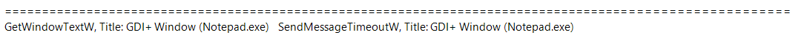

* TOC
{:toc}

## 1. Overview

Both `GetWindowTextW` and `SendMessageTimeoutW` can be used to read the text of a window (HWND), but they work differently. The difference shows up especially when querying **a window that belongs to another process**.

## 2. How Each Function Works

| Function | Behavior |
|----------|----------|
| `GetWindowTextW` | When reading the title of an ordinary top-level window in another process, it does not send `WM_GETTEXT` to the target process. Instead, it retrieves the window text maintained by the system. As a result, the title can be read even when the target process is not responding. |
| `SendMessageTimeoutW` | Sends the specified message to the target window and waits for a reply for the given amount of time. If the window does not respond within the time limit, the call can fail with a timeout. |

> ※ `GetWindowTextW` is not meant for retrieving the text of every control in another process. Text that actually requires `WM_GETTEXT` handling, such as that of custom controls in another process, may not be retrieved.

## 3. Test Results

I split the cases where the two functions return different results into two representative situations. The first is when the window procedure handles `WM_GETTEXT` itself; the second is when the target process cannot respond to messages.

### 3.1 When the Window Procedure Handles WM_GETTEXT Itself

Suppose there is a window class (`Sample`) that, on `WM_GETTEXT`, always returns `"Booga!"` regardless of the actual window title.

```c
SampleWndProc(...)
{
    case WM_GETTEXT:
        lstrcpyn((LPTSTR)lParam, "Booga!", (int)wParam);
        return lstrlen((LPTSTR)lParam);
    case WM_GETTEXTLENGTH: return 7; // lstrlen("Booga!") + null
    ...
}
```

Application A creates a window of this class with the title `"Frappy"`.

```c
hwnd = CreateWindow("Sample", "Frappy", ...);
```

Process B obtains this window's handle somehow and reads its text in two ways.

```c
TCHAR szBuf[80];

GetWindowText(hwnd, szBuf, 80);                    // szBuf = "Frappy"
SendMessage(hwnd, WM_GETTEXT, 80, (LPARAM)szBuf);  // szBuf = "Booga!"
```

`GetWindowText` returns `"Frappy"` because it does not send `WM_GETTEXT` to a window in another process; it reads the window text the system keeps separately (the `"Frappy"` passed to `CreateWindow`). On the other hand, sending `WM_GETTEXT` with `SendMessage` makes the target window procedure answer directly, so you get `"Booga!"`. The same applies when sending it with `SendMessageTimeoutW`.

In other words, for a control whose window procedure handles `WM_GETTEXT` on its own, `GetWindowTextW` and `SendMessageTimeoutW` can return different results.

### 3.2 When the Target Process Cannot Respond

Using the window title of Notepad (Notepad.exe) as the target, I compared the results of `GetWindowTextW` and `SendMessageTimeoutW` while the program was responding normally and while it was not responding.

[](/assets/img/win32-window/gettext_normal_en.png)
*Figure 1. Target program responding normally*

In the normal state, both `GetWindowTextW` and `SendMessageTimeoutW` returned the window title `GDI+ Window (Notepad.exe)`.

[](/assets/img/win32-window/gettext_hung_en.png)
*Figure 2. Target program not responding*

With the target program suspended and unable to respond to messages, `GetWindowTextW` could still read the window title, but `SendMessageTimeoutW` did not get a reply within the time limit and ended in a **TimeOut**.

## 4. Summary

If you want to reliably read the ordinary window title of a window in another process, `GetWindowTextW` is a good choice. If you need the `WM_GETTEXT` result that the target window handles itself, consider `SendMessageTimeoutW`. However, since a timeout can occur when the target program is not responding, you should implement a time limit and failure handling along with it.

## References

- [Raymond Chen, The Old New Thing – GetWindowText() is more complicated than you think](https://devblogs.microsoft.com/oldnewthing/20030821-00/?p=42833/)
- [GetWindowTextW function (MSDN)](https://learn.microsoft.com/en-us/windows/win32/api/winuser/nf-winuser-getwindowtextw)
- [SendMessageTimeoutW function (MSDN)](https://learn.microsoft.com/en-us/windows/win32/api/winuser/nf-winuser-sendmessagetimeoutw)
