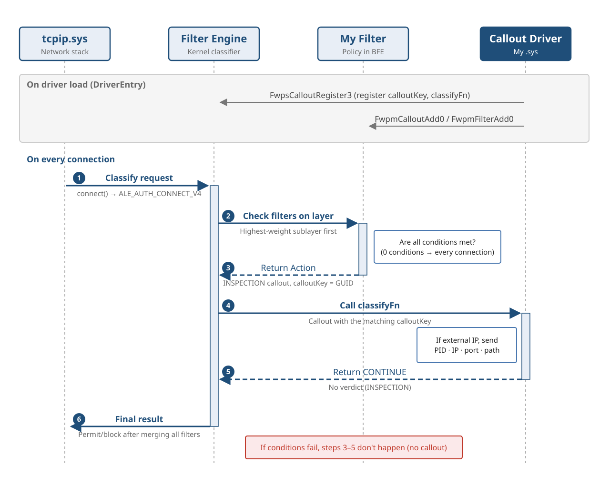

* TOC
{:toc}

## 1. Overview

WFP (Windows Filtering Platform) is the platform and API set Windows provides for building network filtering software. With WFP you can permit or block traffic, and you can also inspect or modify packet data. The built-in Windows Firewall has been implemented on top of WFP since Vista.

This note is based on a driver I wrote while studying WFP. Whenever the PC opens a connection to an external (non-private) IPv4 address, the driver reports the PID, IP, port, and process path as an event. It does not block anything; it only monitors.

## 2. TDI vs. WFP

Before WFP, traffic was monitored by inserting drivers directly into the network stack, such as TDI filters or NDIS filters. This was complex to implement, and when several security products hooked the same spot they tended to conflict with each other. WFP was introduced in Vista (Server 2008) to replace this approach.

| | TDI / NDIS filter | WFP |
|------|----------------|-----|
| How it works | A filter driver is inserted directly into the network stack to intercept traffic. | `tcpip.sys` calls the filter engine at defined points; the developer only registers rules (filters) and callout functions. |
| Where it sits | TDI sits above the transport layer; NDIS sits further down, near the NIC. | Inspection points are split into Filtering Layers (about 50), and you pick the ones you need. |
| Status | TDI is deprecated. | The standard approach since Vista. |

## 3. WFP Components

These are the terms that come up most often in WFP.

| Component | Description |
|----------|------|
| Filter Engine | Decides whether to permit or block traffic based on the registered filters, calling callouts when needed. |
| BFE | Base Filtering Engine. A user-mode service (`bfe.dll` inside `svchost.exe`) that accepts and manages policy objects such as filters and callouts and hands them to the filter engine. `Fwpm*` functions open a session to BFE and add objects. When called from kernel mode, BFE's access checks are skipped. |
| Filtering Layer | An inspection point, such as at `connect()`, at `bind()`, or when packets are sent/received. IPv4 and IPv6 have separate layers. |
| Filter | A single rule made of "conditions + action". Example: call the callout if the remote port is 4000 or higher. |
| Condition | A filter's condition. Multiple conditions are ANDed; conditions that compare the same field are ORed. With zero conditions, all traffic on that layer matches. |
| Callout | The driver function (`classifyFn`) invoked when traffic matches the filter's conditions. Similar to a callback. |
| Sublayer | A grouping of filters. When filters disagree, weights arbitrate between them. If not specified, filters go into `FWPM_SUBLAYER_UNIVERSAL`. |

The diagram below shows the order in which these components actually work.

[](/assets/img/wfp/wfp_call_flow_en.svg)
*Figure 1. WFP call sequence on a new connection*

If the driver registers its callout (`FwpsCalloutRegister3`) and filter (`FwpmCalloutAdd0`, `FwpmFilterAdd0`) when it loads, every subsequent connection triggers the following sequence.

1. When a process calls `connect()`, `tcpip.sys` asks the filter engine to classify it at the `ALE_AUTH_CONNECT_V4` layer.
2. The filter engine checks the filters registered on that layer, starting from the highest-weight sublayer.
3. If all of a filter's conditions are met, the filter engine receives the filter's action (INSPECTION callout) and `calloutKey`.
4. The filter engine finds the callout with the matching `calloutKey` and calls its `classifyFn`.
5. `classifyFn` sends an event if the IP is external and returns `CONTINUE`.
6. The filter engine combines the results of all other filters and tells `tcpip.sys` whether to finally permit or block.

If the conditions are not met, steps 3–5 do not happen. My driver's filter has no conditions, so `classifyFn` is called for every connection on `ALE_AUTH_CONNECT_V4`.

## 4. Source Code Walkthrough

### 4.1 Layer and Action

I used the `FWPM_LAYER_ALE_AUTH_CONNECT_V4` layer. It is invoked when a process attempts an outbound connection (a TCP `connect`, or the first UDP send to a new address). Because it is called once per connection rather than once per packet, the overhead is low, and the PID and process path are available as well.

> ※ As the name says, this layer is IPv4-only. To also monitor IPv6 connections, register one more callout and filter on the `ALE_AUTH_CONNECT_V6` layer.

There are three filter actions, depending on the callout type.

| Action | Behavior |
|------------|------|
| `FWP_ACTION_CALLOUT_TERMINATING` | The callout makes the final decision and must return PERMIT or BLOCK. |
| `FWP_ACTION_CALLOUT_INSPECTION` | Only inspects (logs) and makes no decision. Always returns CONTINUE. |
| `FWP_ACTION_CALLOUT_UNKNOWN` | Returns PERMIT, BLOCK, or CONTINUE depending on the situation. |

Since my driver only monitors and never blocks, it uses `FWP_ACTION_CALLOUT_INSPECTION`, and `classifyFn` always sets `FWP_ACTION_CONTINUE` at the end.

### 4.2 Registration Order

A callout has to be registered in two places, and the two registrations are linked by the same `calloutKey` (GUID). `Fwps*` functions register the actual function with the kernel filter engine; `Fwpm*` functions add the callout/filter information to BFE.

| Step | Function | What it does |
|-----|------|--------|
| 1 | `FwpsCalloutRegister3` | Registers `calloutKey`, `classifyFn`, and `notifyFn` with the filter engine, and returns the `calloutId` used later for unregistration. |
| 2 | `FwpmEngineOpen0` | Opens a filter engine session. Opening it with `FWPM_SESSION_FLAG_DYNAMIC` makes objects added in this session be deleted automatically when it closes. |
| 3 | `FwpmCalloutAdd0` | Adds the `calloutKey` and the layer it applies to (`applicableLayer`) to BFE. |
| 4 | `FwpmFilterAdd0` | Adds a filter specifying the layer, the action (INSPECTION), and the `calloutKey`. With no conditions, every connection on the layer matches. |

```c
FwpsCalloutRegister3(DeviceObject, &CallOut3, &g_CallOutId);
FwpmEngineOpen0(NULL, RPC_C_AUTHN_WINNT, NULL, &session, &g_hEngine);
FwpmCalloutAdd0(g_hEngine, &CallOut0, NULL, NULL);
FwpmFilterAdd0(g_hEngine, &filter, NULL, NULL);
```

Cleanup happens in reverse order: first close the session with `FwpmEngineClose0` to remove the filter, then unregister the callout with `FwpsCalloutUnregisterById0`.

> ※ According to MSDN, if a filter remains after its callout has been unregistered, TERMINATING/UNKNOWN filters are treated as BLOCK and INSPECTION filters are ignored. My code uses INSPECTION, so the impact is small, but when writing a blocking callout you must follow this order.

### 4.3 Reading Values in classifyFn

`classifyFn` is called every time a connection matches the filter. Connection details are read from `inFixedValues->incomingValue[index]`, where the index is one of the per-layer `FWPS_FIELD_ALE_AUTH_CONNECT_V4_*` values.

| Index (prefix `FWPS_FIELD_ALE_AUTH_CONNECT_V4_` omitted) | Meaning | Type |
|------|------|------|
| `IP_REMOTE_ADDRESS` | Remote IP | uint32 |
| `IP_REMOTE_PORT` | Remote port | uint16 |
| `IP_LOCAL_ADDRESS` | Local IP | uint32 |
| `IP_LOCAL_PORT` | Local port | uint16 |
| `IP_PROTOCOL` | Protocol (TCP = 6, UDP = 17) | uint8 |

The IPv4 address WFP passes in is in host byte order, so it can be compared against masks directly without conversion. Private ranges (10.x, 172.16–31.x, 192.168.x) are excluded, and only external IPs are reported.

```c
static BOOLEAN IsPrivateIpv4(UINT32 Ip)
{
    return ((Ip & 0xFF000000) == 0x0A000000) ||   // 10.0.0.0/8
           ((Ip & 0xFFF00000) == 0xAC100000) ||   // 172.16.0.0/12
           ((Ip & 0xFFFF0000) == 0xC0A80000);     // 192.168.0.0/16
}
```

The PID and process path come from `inMetaValues`. Metadata is not guaranteed to be present, so check with `FWPS_IS_METADATA_FIELD_PRESENT` before using it. The process path arrives as a device path such as `\Device\HarddiskVolume3\...`.

```c
if (FWPS_IS_METADATA_FIELD_PRESENT(inMetaValues, FWPS_METADATA_FIELD_PROCESS_PATH) &&
    inMetaValues->processPath != NULL)
{
    // copy processPath->data, processPath->size
}
...
classifyOut->actionType = FWP_ACTION_CONTINUE;   // INSPECTION: no verdict
```

### 4.4 notifyFn

`notifyFn` is called when a filter that uses this callout is added or removed. There is nothing to do here, so it just returns `STATUS_SUCCESS`. `flowDeleteFn` is only needed when attaching context to a flow, so I did not use it.

## 5. Things to Watch Out For

| Item | Details |
|------|------|
| IRQL | `classifyFn` can be called at `DISPATCH_LEVEL`. So use only NonPaged memory (`ExAllocatePool2` + `POOL_FLAG_NON_PAGED`), and avoid wait functions and file/registry access. Hand heavy work off via events to be done elsewhere. |
| Headers | `fwpsk.h` only compiles if an NDIS version macro (`NDIS630`, etc.) is defined first. Include in the order `ndis.h` → `fwpsk.h` → `fwpmk.h`. |
| GUID | Include `initguid.h` before `DEFINE_GUID` so the GUID variables are actually instantiated. The `calloutKey` must not collide with other drivers, so generate your own with guidgen or similar. |
| Library | Add `fwpkclnt.lib` to the linker settings. |
| Testing | A kernel driver bug goes straight to a blue screen, so test in a VM with snapshots. |

## 6. Summary

Instead of inserting itself directly into the network stack like TDI/NDIS filters, WFP lets you monitor or control network traffic by registering filters and callouts. If you only need per-connection monitoring, registering an INSPECTION callout on the `ALE_AUTH_CONNECT` layer gives you the PID, IP, port, and process path with little effort. However, since `classifyFn` can run at elevated IRQL, read MSDN's requirements for every API you plan to use before deciding how to write it. You also need to follow the callout registration/unregistration order.

## 7. Source Code

- **Link:** <https://github.com/LeeGwan/AnticheatSolution_Client/blob/main/AntiCheatDriver/AntiCheatDriver/guard/guard_net.c>
  
## References

- [geunyeong's blog – #1 WFP - Overview (Korean)](https://geun-yeong.tistory.com/55)
- [Windows Filtering Platform (MSDN)](https://learn.microsoft.com/en-us/windows/win32/fwp/windows-filtering-platform-start-page)
- [WFP Architecture (MSDN)](https://learn.microsoft.com/en-us/windows/win32/fwp/windows-filtering-platform-architecture-overview)
- [Access Control (MSDN)](https://learn.microsoft.com/en-us/windows/win32/fwp/access-control)
- [WFP Operation (MSDN)](https://learn.microsoft.com/en-us/windows/win32/fwp/basic-operation)
- [FwpsCalloutRegister3 function (MSDN)](https://learn.microsoft.com/en-us/windows-hardware/drivers/ddi/fwpsk/nf-fwpsk-fwpscalloutregister3)
- [FwpsCalloutUnregisterById0 function (MSDN)](https://learn.microsoft.com/en-us/windows-hardware/drivers/ddi/fwpsk/nf-fwpsk-fwpscalloutunregisterbyid0)
