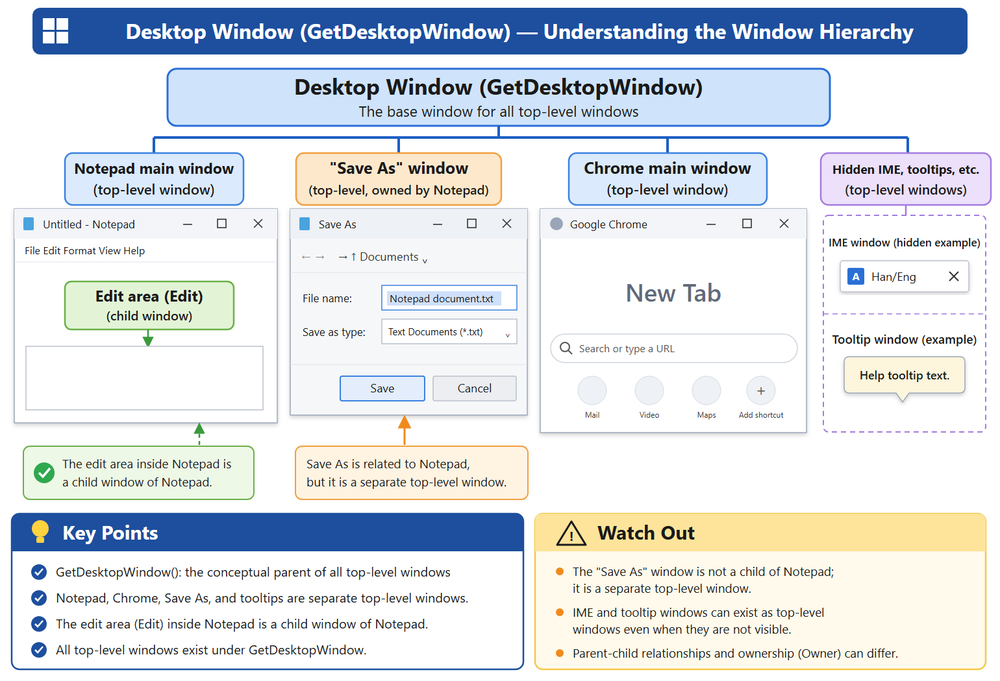

* TOC
{:toc}

## What Is a Top-Level Window?

A top-level window is a window whose parent is the desktop window. It is not a window with no parent at all — it is a window attached directly under the desktop. If a window does not have the `WS_CHILD` style, it is top-level; if it does, it is a child.

*Top-level windows and child windows relative to the desktop window (GetDesktopWindow)*

## What EnumWindows Returns

It returns every window marked as top-level in the diagram above. It does not return just one window per process — if a process owns several top-level windows, you get all of them. Most of them are invisible, so if you only want actual application windows, you need to filter with something like `IsWindowVisible`.

Win32 has no concept of a "main window of a process." To find out which process a window belongs to, you have to check it yourself with `GetWindowThreadProcessId`.

Child windows (controls such as buttons and edit boxes) are not returned. If you need them, call `EnumChildWindows` separately for each top-level window; it walks all the way down through every descendant.

Some windows are not returned at all: message-only windows (under `HWND_MESSAGE`), windows in other sessions or on other desktops, and some Store app windows on Windows 8 and later. Conversely, the Microsoft documentation notes that a few system windows show up in the results even though they have `WS_CHILD`.

## The Confusing Part: GetParent

When I called `GetParent` on a window returned by `EnumWindows`, it returned a value, which confused me: if it has a parent, shouldn't it not be top-level?

Despite its name, `GetParent` behaves like this:

- For a child window, it returns the real parent.
- For a top-level window that has `WS_POPUP` and an owner, it returns the owner.
  - Example: Notepad's "Save As" popup window
- For all other top-level windows, it returns `NULL`. It never tells you about the desktop.

So a value returned by `GetParent` for a window from `EnumWindows` is not the parent but the **owner**. For example, calling `GetParent` on the "Save As" window returns Notepad's main window.

To avoid confusion, get them separately:

- Parent: `GetAncestor(hwnd, GA_PARENT)`
- Owner: `GetWindow(hwnd, GW_OWNER)`

## References

- [EnumWindowsProc callback function (MSDN)](https://learn.microsoft.com/en-us/previous-versions/windows/desktop/legacy/ms633498(v=vs.85))
- [EnumWindows function (MSDN)](https://learn.microsoft.com/en-us/windows/win32/api/winuser/nf-winuser-enumwindows)
- [IsWindowVisible function (MSDN)](https://learn.microsoft.com/en-us/windows/win32/api/winuser/nf-winuser-iswindowvisible)
- [GetParent function (MSDN)](https://learn.microsoft.com/en-us/windows/win32/api/winuser/nf-winuser-getparent)
- [GetWindow function (MSDN)](https://learn.microsoft.com/en-us/windows/win32/api/winuser/nf-winuser-getwindow)
