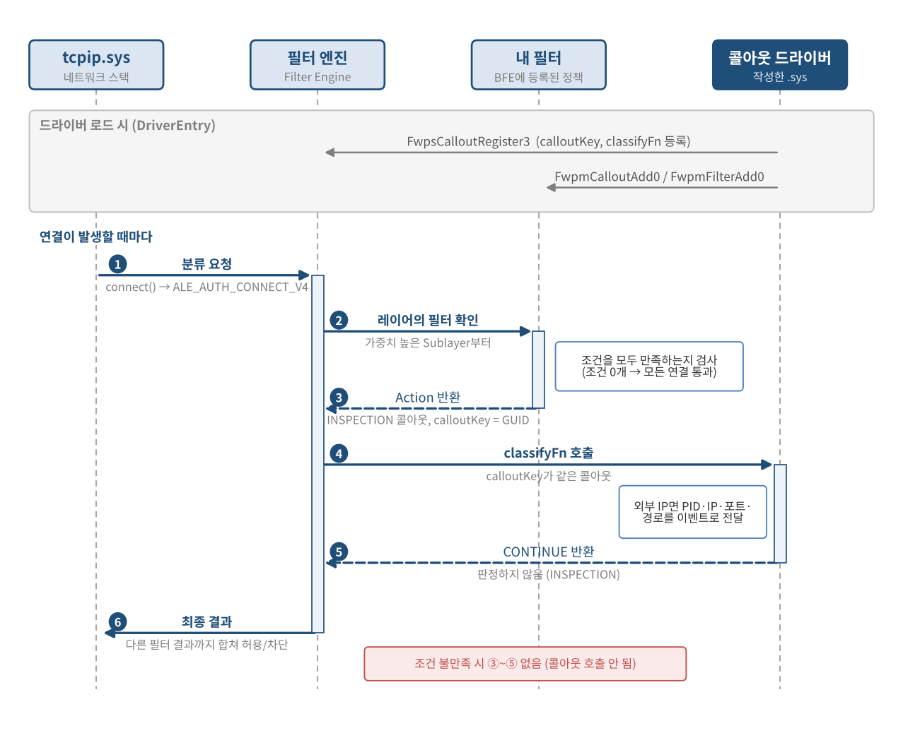

* TOC
{:toc}

## 1. 개요

WFP(Windows Filtering Platform)는 Windows에서 네트워크 필터링 프로그램을 만들 수 있도록 제공되는 플랫폼과 API입니다. WFP를 사용하면 트래픽을 허용하거나 차단할 수 있고, 패킷 데이터를 확인하거나 변경할 수도 있습니다. Windows 기본 방화벽도 Vista부터 WFP로 구현되어 있습니다.

이 문서는 WFP를 공부하면서 작성한 드라이버 소스를 기준으로 정리했습니다. 작성한 드라이버는 PC에서 외부(사설 대역이 아닌) IPv4 주소로 나가는 연결이 발생하면 PID, IP, 포트, 프로세스 경로를 이벤트로 전달합니다. 연결을 차단하지는 않고 확인만 합니다.

## 2. TDI와 WFP

WFP가 나오기 전에는 TDI 필터나 NDIS 필터처럼 네트워크 스택에 드라이버를 직접 올려서 트래픽을 확인했습니다. 이 방식은 구현이 복잡하고, 여러 보안 제품이 같은 위치에 드라이버를 올리면 서로 충돌하기 쉬웠습니다. 그래서 Vista(서버는 2008)부터 이를 대체하기 위해 WFP가 추가되었습니다.

| 구분 | TDI / NDIS 필터 | WFP |
|------|----------------|-----|
| 동작 방식 | 네트워크 스택에 필터 드라이버를 직접 끼워 넣어 트래픽을 가로챕니다. | `tcpip.sys`가 정해진 시점마다 필터 엔진을 호출하고, 개발자는 규칙(필터)과 콜아웃 함수만 등록합니다. |
| 위치 | TDI는 전송 계층 위, NDIS는 그보다 아래 NIC 쪽에 붙습니다. | Filtering Layer(약 50개)로 시점이 나뉘어 있어 원하는 시점을 골라서 사용합니다. |
| 현재 상태 | TDI는 더 이상 권장되지 않습니다(deprecated). | Vista 이후 표준 방식입니다. |

## 3. WFP 구성 요소

WFP에서 자주 나오는 용어는 다음과 같습니다.

| 구성 요소 | 설명 |
|----------|------|
| Filter Engine | 등록된 필터를 기준으로 트래픽을 허용/차단할지 판단합니다. 필요하면 콜아웃을 호출합니다. |
| BFE | Base Filtering Engine. 유저 모드 서비스(`svchost.exe` 안의 `bfe.dll`)로, 필터와 콜아웃 같은 정책 객체를 받아서 관리하고 필터 엔진에 전달합니다. `Fwpm*` 함수는 BFE에 세션을 열고 객체를 추가합니다. 커널 모드에서 호출하면 BFE의 접근 권한 검사는 생략됩니다. |
| Filtering Layer | 검사 시점입니다. 예를 들어 `connect()` 시점, `bind()` 시점, 패킷 송수신 시점 등이 있고 IPv4와 IPv6가 따로 나뉘어 있습니다. |
| Filter | 규칙 하나입니다. "조건 + 행동(Action)"으로 구성됩니다. 예: 원격 포트가 4000 이상이면 콜아웃 호출. |
| Condition | 필터의 조건입니다. 여러 개면 AND로 처리되고, 같은 항목을 비교하는 조건끼리는 OR로 처리됩니다. 0개면 해당 레이어의 모든 트래픽이 대상입니다. |
| Callout | 필터 조건에 맞는 트래픽이 들어오면 호출되는 드라이버 함수(`classifyFn`)입니다. 콜백 함수와 비슷합니다. |
| Sublayer | 필터를 묶는 단위입니다. 필터끼리 결과가 다를 때 가중치로 중재합니다. 지정하지 않으면 `FWPM_SUBLAYER_UNIVERSAL`에 들어갑니다. |

위 구성 요소가 실제로 어떤 순서로 동작하는지 그림으로 정리하면 다음과 같습니다.

[](/assets/img/wfp/wfp_call_flow.png)
*그림 1. 연결 발생 시 WFP 호출 순서*

드라이버가 로드될 때 콜아웃(`FwpsCalloutRegister3`)과 필터(`FwpmCalloutAdd0`, `FwpmFilterAdd0`)를 미리 등록해 두면, 이후 연결이 발생할 때마다 다음 순서로 호출됩니다.

1. 프로세스가 `connect()`를 호출하면 `tcpip.sys`가 `ALE_AUTH_CONNECT_V4` 레이어로 필터 엔진에 분류를 요청합니다.
2. 필터 엔진은 가중치가 높은 Sublayer부터 이 레이어에 등록된 필터를 확인합니다.
3. 필터의 조건을 모두 만족하면 필터에 지정된 Action(INSPECTION 콜아웃)과 `calloutKey`를 필터 엔진이 받습니다.
4. 필터 엔진은 `calloutKey`가 같은 콜아웃을 찾아 `classifyFn`을 호출합니다.
5. `classifyFn`은 외부 IP인 경우 이벤트를 전달하고 `CONTINUE`를 반환합니다.
6. 필터 엔진은 다른 필터의 결과까지 합쳐서 최종적으로 허용할지 차단할지 `tcpip.sys`에 알려줍니다.

조건을 만족하지 않으면 3~5는 일어나지 않습니다. 작성한 드라이버는 필터에 조건을 넣지 않았기 때문에 `ALE_AUTH_CONNECT_V4`의 모든 연결에서 `classifyFn`이 호출됩니다.

## 4. 소스 코드 정리

### 4.1 사용한 레이어와 Action

레이어는 `FWPM_LAYER_ALE_AUTH_CONNECT_V4`를 사용했습니다. 프로세스가 외부로 연결을 시도할 때(TCP `connect`, UDP는 새 주소로 처음 보낼 때) 호출되는 레이어입니다. 패킷마다 호출되는 것이 아니라 연결당 한 번 호출되어 부하가 적고, PID와 프로세스 경로도 함께 받을 수 있습니다.

> ※ 이름 그대로 IPv4 전용입니다. IPv6 연결까지 확인하려면 `ALE_AUTH_CONNECT_V6` 레이어에 콜아웃과 필터를 하나씩 더 등록해야 합니다.

필터의 Action은 콜아웃 종류에 따라 세 가지가 있습니다.

| Action 종류 | 동작 |
|------------|------|
| `FWP_ACTION_CALLOUT_TERMINATING` | 콜아웃이 최종 판정을 내립니다. PERMIT 또는 BLOCK을 반환해야 합니다. |
| `FWP_ACTION_CALLOUT_INSPECTION` | 확인(로깅)만 하고 판정은 하지 않습니다. 항상 CONTINUE를 반환합니다. |
| `FWP_ACTION_CALLOUT_UNKNOWN` | 상황에 따라 PERMIT, BLOCK, CONTINUE 중 하나를 반환합니다. |

작성한 드라이버는 차단 없이 확인만 하므로 `FWP_ACTION_CALLOUT_INSPECTION`을 사용했고, `classifyFn` 마지막에 항상 `FWP_ACTION_CONTINUE`를 설정합니다.

### 4.2 등록 순서

콜아웃은 두 곳에 등록해야 하고, 두 등록은 같은 `calloutKey`(GUID)로 연결됩니다. `Fwps*` 함수는 실제 함수를 커널 필터 엔진에 등록하고, `Fwpm*` 함수는 콜아웃/필터 정보를 BFE에 추가합니다.

| 순서 | 함수 | 하는 일 |
|-----|------|--------|
| 1 | `FwpsCalloutRegister3` | `calloutKey`, `classifyFn`, `notifyFn`을 필터 엔진에 등록합니다. 해제할 때 사용할 `calloutId`를 받아 둡니다. |
| 2 | `FwpmEngineOpen0` | 필터 엔진 세션을 엽니다. `FWPM_SESSION_FLAG_DYNAMIC`으로 열면 세션을 닫을 때 이 세션에서 추가한 객체가 자동으로 삭제됩니다. |
| 3 | `FwpmCalloutAdd0` | `calloutKey`와 사용할 레이어(`applicableLayer`)를 BFE에 추가합니다. |
| 4 | `FwpmFilterAdd0` | 레이어, Action(INSPECTION), `calloutKey`를 지정해서 필터를 추가합니다. 조건을 넣지 않았으므로 해당 레이어의 모든 연결이 대상입니다. |

```c
FwpsCalloutRegister3(DeviceObject, &CallOut3, &g_CallOutId);
FwpmEngineOpen0(NULL, RPC_C_AUTHN_WINNT, NULL, &session, &g_hEngine);
FwpmCalloutAdd0(g_hEngine, &CallOut0, NULL, NULL);
FwpmFilterAdd0(g_hEngine, &filter, NULL, NULL);
```

해제는 반대 순서로 합니다. 먼저 `FwpmEngineClose0`으로 세션을 닫아 필터를 지우고, 그다음 `FwpsCalloutUnregisterById0`으로 콜아웃을 해제합니다.

> ※ MSDN 기준으로 콜아웃이 해제된 상태에서 필터만 남아 있으면 TERMINATING/UNKNOWN 필터는 BLOCK으로 처리되고, INSPECTION 필터는 무시됩니다. 작성한 코드는 INSPECTION이라 영향은 적지만, 차단용 콜아웃을 만들 때는 순서를 꼭 지켜야 합니다.

### 4.3 classifyFn에서 값 가져오기

`classifyFn`은 필터 조건에 맞는 연결이 생길 때마다 호출됩니다. 연결 정보는 `inFixedValues->incomingValue[인덱스]`에서 꺼내고, 인덱스는 레이어별로 정의된 `FWPS_FIELD_ALE_AUTH_CONNECT_V4_*` 값을 사용합니다.

| 인덱스 (앞의 `FWPS_FIELD_ALE_AUTH_CONNECT_V4_` 생략) | 의미 | 타입 |
|------|------|------|
| `IP_REMOTE_ADDRESS` | 원격 IP | uint32 |
| `IP_REMOTE_PORT` | 원격 포트 | uint16 |
| `IP_LOCAL_ADDRESS` | 로컬 IP | uint32 |
| `IP_LOCAL_PORT` | 로컬 포트 | uint16 |
| `IP_PROTOCOL` | 프로토콜 (TCP = 6, UDP = 17) | uint8 |

WFP가 넘겨주는 IPv4 주소는 호스트 바이트 오더이므로 별도 변환 없이 바로 마스크로 비교할 수 있습니다. 사설 대역(10.x, 172.16~31.x, 192.168.x)은 제외하고 외부 IP만 이벤트로 보냅니다.

```c
static BOOLEAN IsPrivateIpv4(UINT32 Ip)
{
    return ((Ip & 0xFF000000) == 0x0A000000) ||   // 10.0.0.0/8
           ((Ip & 0xFFF00000) == 0xAC100000) ||   // 172.16.0.0/12
           ((Ip & 0xFFFF0000) == 0xC0A80000);     // 192.168.0.0/16
}
```

PID와 프로세스 경로는 `inMetaValues`에서 가져옵니다. 메타데이터는 항상 들어온다는 보장이 없어서 `FWPS_IS_METADATA_FIELD_PRESENT`로 먼저 확인한 뒤 사용합니다. 프로세스 경로는 `\Device\HarddiskVolume3\...` 같은 장치 경로 형식으로 들어옵니다.

```c
if (FWPS_IS_METADATA_FIELD_PRESENT(inMetaValues, FWPS_METADATA_FIELD_PROCESS_PATH) &&
    inMetaValues->processPath != NULL)
{
    // processPath->data, processPath->size 복사
}
...
classifyOut->actionType = FWP_ACTION_CONTINUE;   // INSPECTION이므로 판정하지 않음
```

### 4.4 notifyFn

`notifyFn`은 이 콜아웃을 사용하는 필터가 추가되거나 삭제될 때 호출됩니다. 따로 할 일이 없어서 `STATUS_SUCCESS`만 반환합니다. `flowDeleteFn`은 연결(flow)에 컨텍스트를 붙일 때만 필요해서 사용하지 않았습니다.

## 5. 주의할 점

| 항목 | 내용 |
|------|------|
| IRQL | `classifyFn`은 `DISPATCH_LEVEL`에서 호출될 수 있습니다. 그래서 NonPaged 메모리(`ExAllocatePool2` + `POOL_FLAG_NON_PAGED`)만 사용하고, 대기 함수나 파일/레지스트리 접근은 하지 않습니다. 무거운 처리는 이벤트로 넘겨서 다른 곳에서 합니다. |
| 헤더 | `fwpsk.h`는 NDIS 버전 매크로(`NDIS630` 등)가 먼저 정의되어 있어야 컴파일됩니다. `ndis.h` → `fwpsk.h` → `fwpmk.h` 순서로 포함합니다. |
| GUID | `DEFINE_GUID` 전에 `initguid.h`를 포함해야 GUID 변수가 실제로 생성됩니다. `calloutKey`는 다른 드라이버와 겹치면 안 되므로 guidgen 등으로 직접 생성한 값을 사용해야 합니다. |
| 라이브러리 | 링커 설정에 `fwpkclnt.lib`를 추가합니다. |
| 테스트 | 커널 드라이버 오류는 바로 블루스크린으로 이어지므로 스냅샷이 가능한 VM에서 테스트합니다. |

## 6. 정리

WFP는 TDI/NDIS 필터처럼 네트워크 스택에 직접 끼어들지 않고, 필터와 콜아웃을 등록하는 방식으로 네트워크 트래픽을 확인하거나 제어할 수 있습니다. 연결 단위로 확인만 하는 경우에는 `ALE_AUTH_CONNECT` 레이어에 INSPECTION 콜아웃을 등록하면 PID, IP, 포트, 프로세스 경로를 간단하게 얻을 수 있습니다. 다만 `classifyFn`은 높은 IRQL에서 호출될 수 있으므로, 사용할 API는 MSDN의 요구 사항을 읽어본 후 어떻게 짜야 할지 정해야 합니다. 또한 콜아웃 등록/해제 순서를 지켜야 합니다.

## 참고

- [geunyeong's blog – #1 WFP - 개요](https://geun-yeong.tistory.com/55)
- [Windows Filtering Platform(MSDN)](https://learn.microsoft.com/ko-kr/windows/win32/fwp/windows-filtering-platform-start-page)
- [WFP Architecture(MSDN)](https://learn.microsoft.com/en-us/windows/win32/fwp/windows-filtering-platform-architecture-overview)
- [Access control(MSDN)](https://learn.microsoft.com/en-us/windows/win32/fwp/access-control)
- [WFP Operation(MSDN)](https://learn.microsoft.com/ko-kr/windows/win32/fwp/basic-operation)
- [FwpsCalloutRegister3 함수(MSDN)](https://learn.microsoft.com/ko-kr/windows-hardware/drivers/ddi/fwpsk/nf-fwpsk-fwpscalloutregister3)
- [FwpsCalloutUnregisterById0 함수(MSDN)](https://learn.microsoft.com/ko-kr/windows-hardware/drivers/ddi/fwpsk/nf-fwpsk-fwpscalloutunregisterbyid0)
