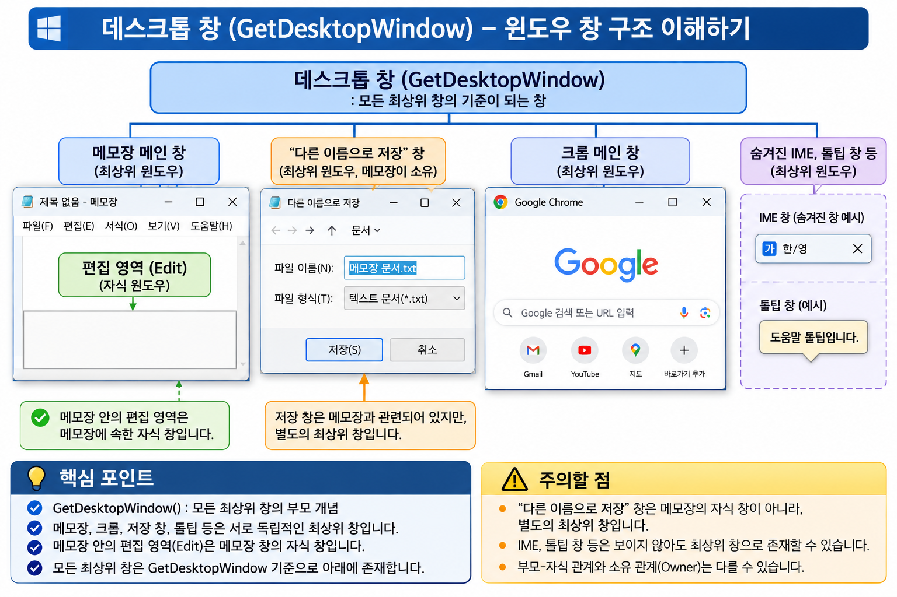

* TOC
{:toc}

## 최상위 창이 뭔가

최상위 창은 부모가 데스크톱 창인 창이다. 부모가 아예 없는 창이 아니라, 데스크톱 바로 아래에 붙어 있는 창. `WS_CHILD` 스타일이 없으면 최상위, 있으면 자식이다.

*데스크톱 창(GetDesktopWindow)을 기준으로 본 최상위 창과 자식 창의 관계*

## EnumWindows가 주는 것

위 그림에서 최상위라고 적힌 걸 전부 준다. 프로세스당 하나만 주는 게 아니라, 한 프로세스가 최상위 창을 여러 개 갖고 있으면 다 온다. 그리고 대부분은 안 보이는 창이라서 실제 프로그램 창만 보고 싶으면 `IsWindowVisible` 같은 걸로 걸러야 한다.

Win32에는 "프로세스의 대표 창"이라는 개념이 없다. 어느 프로세스 창인지는 `GetWindowThreadProcessId`로 직접 확인해야 한다.

자식 창(버튼, 에디트 같은 컨트롤)은 안 온다. 필요하면 최상위 창마다 `EnumChildWindows`를 따로 부르면 되고, 이건 자식 창까지 전부 내려간다.

안 나오는 것도 있다. 메시지 전용 창(`HWND_MESSAGE` 아래), 다른 세션이나 다른 데스크톱의 창, Windows 8 이후 일부 스토어 앱 창. 반대로 시스템 창 몇 개는 `WS_CHILD`인데도 섞여 나온다고 MS 문서에 적혀 있다.

## 헷갈렸던 부분: GetParent

`EnumWindows`로 받은 창에 `GetParent`를 했더니 값이 나와서, 부모가 있으면 최상위가 아닌 거 아닌가 하고 헷갈렸다.

`GetParent`는 이름과 다르게 이렇게 동작한다.

- 자식 창을 넣으면 진짜 부모를 준다.
- 최상위 창인데 `WS_POPUP`이고 소유자가 있으면 소유자를 준다.
  - 예: 메모장의 "다른 이름으로 저장" 팝업 창
- 나머지 최상위 창은 `NULL`을 준다. 데스크톱은 알려주지 않는다.

그러니까 `EnumWindows` 결과에서 `GetParent`로 나온 값은 부모가 아니라 **소유자**다. 예를 들어 "다른 이름으로 저장" 창에 `GetParent`를 하면 메모장 메인 창이 나온다.

헷갈리지 않으려면 따로 구한다.

- 부모는 `GetAncestor(hwnd, GA_PARENT)`
- 소유자는 `GetWindow(hwnd, GW_OWNER)`

## 참고

- [EnumWindowsProc 콜백 함수 설명(MSDN)](https://learn.microsoft.com/ko-kr/previous-versions/windows/desktop/legacy/ms633498(v=vs.85))
- [EnumWindows 함수(MSDN)](https://learn.microsoft.com/ko-kr/windows/win32/api/winuser/nf-winuser-enumwindows)
- [IsWindowVisible 함수(MSDN)](https://learn.microsoft.com/ko-kr/windows/win32/api/winuser/nf-winuser-iswindowvisible)
- [GetParent 함수(MSDN)](https://learn.microsoft.com/ko-kr/windows/win32/api/winuser/nf-winuser-getparent)
- [GetWindow 함수(MSDN)](https://learn.microsoft.com/ko-kr/windows/win32/api/winuser/nf-winuser-getwindow)
